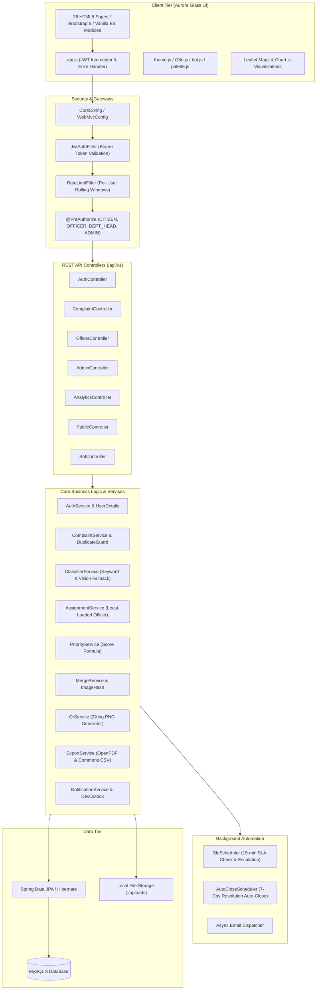
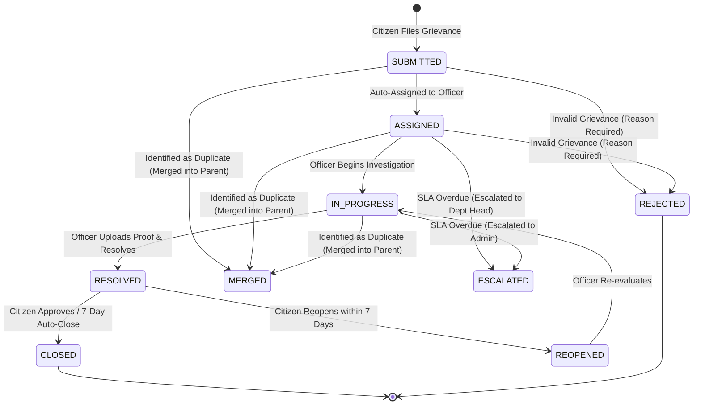

# CivicPulse — Smart Government Grievance Management System

[](https://openjdk.org/)
[](https://spring.io/projects/spring-boot)
[](https://spring.io/projects/spring-security)
[](https://www.mysql.com/)
[](https://getbootstrap.com/)
[](https://leafletjs.com/)
[](https://www.chartjs.org/)
[](https://github.com/)
[](docs/QA-CHECKLIST.md)
[](docs/FEATURE-VERIFICATION.md)

> A modern, end-to-end civic grievance management platform built for the **Infosys Virtual Internship 7.0**. CivicPulse bridges citizens and local municipal authorities with automated issue categorization, proximity duplicate detection, intelligent SLA tracking, interactive Kanban workflows, public transparency dashboards, and real-time civic assistance.

---

## 🌟 Key Highlights & Features

### 🎨 Modern "Aurora Glass" Experience
- **Aesthetic:** Glassmorphism surfaces, subtle background gradients, spotlight card hover glow, and 3D micro-tilt interactions.
- **Theme Support:** Instant Light / Dark mode toggle with persistent state and smooth color transitions.
- **Localization (i18n):** Complete trilingual support in **English**, **Kannada (ಕನ್ನಡ)**, and **Hindi (हिंदी)**.
- **Command Palette:** Quick keyboard navigation anywhere via `Ctrl + K`.
- **Accessibility:** WCAG AA color contrast, explicit keyboard focus rings, and support for `prefers-reduced-motion`.

### 📝 Smart Citizen Grievance Filing
- **4-Step Wizard:** Intuitive step-by-step submission (Details → Location → Evidence → Review).
- **Auto-Categorization:** Real-time keyword classification engine automatically suggests categories and routes to the proper department.
- **Interactive Map Picker:** Leaflet-powered pin placement, GPS "Use My Location", and address autofill.
- **Evidence Upload:** Multi-file drag-and-drop uploader supporting JPEG, PNG, WEBP, and PDF with live previews.
- **Privacy Protection:** Optional Anonymous Mode hides citizen identity from officers and public views.
- **Instant Receipt & QR Code:** Downloads official PDF receipt with embedded ZXing QR code for quick scanning.

### 🛡️ Proximity & Duplicate Prevention Engine
- **Exact-Duplicate Guard:** Rejects identical text submissions from the same citizen within 24 hours (`409 Conflict`).
- **Proximity Detection:** Checks complaints within a 300m radius using Haversine distance and text similarity.
- **Community "Support / Me Too":** Citizens can upvote and follow existing nearby grievances instead of filing duplicates.
- **Image Hashing:** Identifies identical or near-duplicate evidence images using perceptual dHash and SHA-256.
- **Officer Merge Workflow:** Officers can merge child complaints into a canonical parent complaint; community upvotes and followers transfer seamlessly.

### ⚡ Field Officer Command Center
- **Workload Queue:** Filter grievances by status, priority, department, SLA urgency, or search keywords.
- **Visual Kanban Board:** Drag-and-drop status management across `Assigned`, `In Progress`, and `Resolved`.
- **Workspace Drawer:** Slide-out panel for fast review, internal staff notes, reassignment, and proof photo uploads.
- **SLA Countdown & Auto-Escalation:** Color-coded SLA rings alert officers to approaching deadlines. Overdue grievances escalate automatically from Officer → Department Head → Admin.
- **Resolution Verification:** Mandatory resolution remarks and photo proofs prior to closing.

### 📊 Executive Analytics & Transparency
- **Real-Time KPIs:** Dynamic counters for total grievances, resolution rates, average resolution time, and satisfaction.
- **Visual Analytics:** Interactive Chart.js charts for volume trends, category breakdowns, and department performance.
- **Interactive Heatmap:** Leaflet heat layer visualizing civic issue hotspots across the city.
- **Hotspot Prediction:** Automated predictive analysis flagging geographic clusters exceeding 1.5× baseline volume.
- **Data Export:** Instant one-click exports to CSV datasets and styled executive PDF reports.
- **Public Transparency Portal:** Citizen-facing dashboard displaying anonymized municipal performance metrics.

### 🤖 CivicBot Virtual Assistant
- **Interactive Assistant:** Floating chatbot widget with animated typing pulse and quick-reply action chips.
- **FAQ Knowledge Base:** Instant answers to common municipal questions, filing guides, and operating hours.
- **Live Tracking:** Query `Track CP-YYYY-######` directly in the chat to get live real-time status and progress updates.

---

## 🏛️ System Architecture



---

## 🔄 Grievance State Machine



---

## 👥 Demo Accounts & Credentials

The application automatically seeds demonstration accounts on first boot:

| Role | Email Address | Password | Permissions & Scope |
|---|---|---|---|
| **System Admin** | `admin@civicpulse.test` | `Password@123` | Complete administrative access: system settings, user management, audit logs, SLA scheduler, keyword rules, and analytics exports. |
| **Department Head** | `head.roads@civicpulse.test` | `Password@123` | Roads & Infrastructure supervision, officer workload oversight, escalation queue. |
| **Field Officer** | `officer.roads@civicpulse.test` | `Password@123` | Roads field officer: complaint queue, Kanban board, status transitions, resolution proof upload, internal notes, duplicate merges. |
| **Citizen User** | `citizen@civicpulse.test` | `Password@123` | Standard citizen account: grievance filing wizard, personal dashboard, status tracking, notifications, feedback submission. |

---

## 🚀 Quickstart Guide

### Option 1: Run Locally (Maven + MySQL)

#### 1. Prerequisites
- **JDK 17 or higher** (`java -version`)
- **Maven 3.8+** (`mvn -v`)
- **MySQL 8.0+** running on `localhost:3306`

#### 2. Create Database
```sql
CREATE DATABASE civicpulse CHARACTER SET utf8mb4 COLLATE utf8mb4_unicode_ci;
```

#### 3. Configure Environment Variables
Copy `.env.example` to `.env` or set environment variables:
```bash
DB_URL=jdbc:mysql://localhost:3306/civicpulse
DB_USER=root
DB_PASS=Root@2806.
JWT_SECRET=404E635266556A586E3272357538782F413F4428472B4B6250645367566B5970
UPLOAD_DIR=./uploads
APP_PUBLIC_BASE_URL=http://localhost:8080
```

#### 4. Build and Start the Application
```bash
mvn spring-boot:run "-Dspring-boot.run.profiles=dev"
```
The server will start at **`http://localhost:8080`**. Open your browser to explore the platform.

---

### Option 2: Run with Docker Compose

Run the entire application along with a containerized MySQL instance:
```bash
docker compose up --build
```
The app will automatically wait for the database health check and seed initial data. Access the web app at `http://localhost:8080`.

---

## 🧪 Testing & Verification

### 1. Automated Test Suite (JUnit 5 + Spring Boot Test)
Run all 31 unit and integration tests:
```bash
mvn test
```
*Result: 31 tests run, 0 failures, 0 errors.*

### 2. End-to-End Smoke Test Suite
Run the 35-step automated integration smoke test suite against a running server:

**Using PowerShell (Windows):**
```powershell
./scripts/smoke-test.ps1
```

**Using Bash / Git Bash (Linux / macOS / Windows):**
```bash
./scripts/smoke-test.sh
```

Both test scripts execute all steps (S01 to S33 + S18b, S19b) verifying citizen registration, complaint filing, duplicate guards, officer queues, status transitions, proof uploads, citizen feedback, SLA escalations, QR generation, rate limiting, and actuator health.

---

## 📖 API Documentation

Once the server is running, explore the interactive OpenAPI / Swagger documentation:
- **Swagger UI:** `http://localhost:8080/swagger-ui.html`
- **OpenAPI JSON:** `http://localhost:8080/v3/api-docs`

### Key API Endpoints Summary

| Method | Endpoint | Description | Auth Required |
|---|---|---|---|
| `POST` | `/api/v1/auth/register` | Register new citizen with terms consent | Public |
| `POST` | `/api/v1/auth/login` | Authenticate user; returns JWT & refresh token | Public |
| `POST` | `/api/v1/complaints/classify` | Suggest category & department from complaint text | Public |
| `POST` | `/api/v1/complaints` | Submit new grievance with multipart attachments | CITIZEN |
| `GET` | `/api/v1/complaints/mine` | List grievances filed by logged-in citizen | CITIZEN |
| `GET` | `/api/v1/complaints/{id}` | Get full complaint details & timeline | CITIZEN / OFFICER |
| `POST` | `/api/v1/complaints/{id}/support` | Follow / upvote grievance (idempotent) | CITIZEN |
| `POST` | `/api/v1/complaints/{id}/feedback` | Submit 1–5 star rating and feedback | CITIZEN |
| `GET` | `/api/v1/officer/complaints` | Filter and paginate officer grievance queue | OFFICER / DEPT_HEAD |
| `GET` | `/api/v1/officer/board` | Get grievances grouped by status for Kanban board | OFFICER / DEPT_HEAD |
| `PATCH` | `/api/v1/officer/complaints/{id}/status`| Change grievance status with mandatory remark | OFFICER / DEPT_HEAD |
| `POST` | `/api/v1/officer/complaints/{id}/proof` | Upload resolution proof photo | OFFICER / DEPT_HEAD |
| `POST` | `/api/v1/officer/complaints/{id}/merge` | Merge duplicate grievance into parent | OFFICER / DEPT_HEAD |
| `GET` | `/api/v1/admin/analytics/summary` | Retrieve high-level KPI counts | ADMIN |
| `GET` | `/api/v1/admin/analytics/heatmap` | Retrieve geolocation coordinates for map heatmap | ADMIN |
| `GET` | `/api/v1/admin/analytics/export` | Download report export (`format=csv` or `pdf`) | ADMIN |
| `POST` | `/api/v1/admin/sla/trigger-scheduler` | Trigger manual SLA audit & escalation | ADMIN |
| `GET` | `/api/v1/public/track/{code}` | Public tracking query (anonymized DTO) | Public |
| `GET` | `/api/v1/public/qr/{code}.png` | Generate ZXing QR code image pointing to tracker | Public |
| `POST` | `/api/v1/bot/message` | Send message to CivicBot assistant | Public |
| `GET` | `/actuator/health` | Application health and readiness status | Public |

---

## 📁 Project Structure

```
CivicPulse/
├── .github/workflows/ci.yml         # GitHub Actions CI workflow
├── Dockerfile                       # Multi-stage container build
├── docker-compose.yml               # App + MySQL container orchestration
├── pom.xml                          # Maven build dependencies
├── scripts/
│   ├── smoke-test.ps1               # PowerShell smoke test runner (S01–S33)
│   └── smoke-test.sh                # POSIX bash smoke test runner (S01–S33)
├── docs/
│   ├── PRD.md                       # Product Requirements Document
│   ├── design.md                    # Aurora Glass UI/UX Specification
│   ├── memory.md                    # Architecture decisions & constraints
│   ├── rules.md                     # Security & coding standards
│   ├── task.md                      # Phased project plan & checklist
│   ├── FEATURE-VERIFICATION.md      # Complete feature verification matrix (97/97 PASS)
│   ├── QA-CHECKLIST.md              # Quality assurance checklist & test protocol
│   └── DEPLOYMENT.md                # Cloud production deployment guide
└── src/
    ├── main/java/com/civicpulse/
    │   ├── config/                  # Security, Web, CORS, Async, Swagger configs
    │   ├── controller/              # REST API controllers
    │   ├── dto/                     # Request and Response transfer objects
    │   ├── entity/                  # JPA entities
    │   ├── enums/                   # Role, ComplaintStatus, Urgency, etc.
    │   ├── exception/               # Global exception handlers
    │   ├── repository/              # Spring Data JPA repositories
    │   ├── scheduler/               # SlaScheduler & AutoCloseScheduler
    │   ├── security/                # JWT filters, UserDetails, token generation
    │   ├── service/                 # Service interfaces & implementations
    │   └── util/                    # CodeGenerator, GeoUtils, ImageHash, etc.
    ├── main/resources/
    │   ├── application.yml          # Base Spring configuration
    │   ├── application-dev.yml      # Development environment profile
    │   ├── application-prod.yml     # Production container profile
    │   └── static/                  # Vanilla JS frontend & assets
    │       ├── index.html           # Landing page
    │       ├── login.html           # Authentication portal
    │       ├── register.html        # Citizen registration
    │       ├── track.html           # Public grievance tracker
    │       ├── transparency.html    # Public analytics dashboard
    │       ├── citizen/             # Citizen portal pages (wizard, my complaints, etc.)
    │       ├── officer/             # Field officer queue, Kanban board, drawer
    │       ├── admin/               # Admin dashboard, user management, audit logs, rules
    │       ├── css/                 # tokens.css, base.css, aurora glass styling
    │       └── js/                  # api.js, auth.js, theme.js, i18n.js, bot.js
    └── test/java/com/civicpulse/     # Automated JUnit 5 test suite
```

---

## 🛡️ Security & Privacy Assurance

- **BCrypt Password Hashing:** All credentials securely hashed before database storage.
- **Stateless JWT Tokens:** Short-lived access tokens with secure refresh token rotation.
- **Role-Based Access Control:** Strict `@PreAuthorize` authorization checks on all officer and administrative endpoints.
- **Anonymity Guarantee:** Citizens can file grievances anonymously; identities are scrubbed from officer drawers, public APIs, and QR links.
- **Input Sanitization:** Parameterized SQL queries via Hibernate prevent SQL injection; text content is escaped to prevent XSS.
- **Hardened File Storage:** Uploaded files receive cryptographically random UUID names, stored outside web root, with strict MIME type and size checks.

---

## 👥 Project Team

Built for the **Infosys Virtual Internship 7.0**:
- **Project Associates:** Sriya, Tarun B, Syed Zain, Yogendra Kumar
- **Project Mentor:** Ragul S

---

## 📄 License

This project is licensed under the [MIT License](LICENSE).
